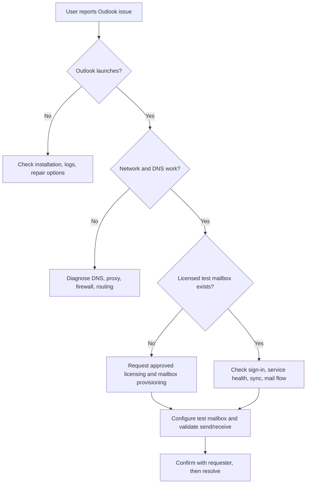

# Case Study 02 — Outlook / Exchange Online Mailbox Availability Investigation

**Project:** ServiceNow Enterprise Help Desk Lab — 2026  
**Organization:** Northstar Technology Services (fictional)  
**ServiceNow Incident:** INC0010002  
**Date:** November 5, 2026  
**Classification:** Simulated end-user report; real lab diagnostics  
**Document status:** Investigation documented; service not restored; incident left On Hold in ServiceNow  

## Executive summary

A fictional employee, Emily Carter, reported that Outlook could not connect to Exchange Online and that mail was not sending or receiving. The help desk recorded the report in ServiceNow, assigned it to Tier 1, ran endpoint and network tests in a Windows 11 VM, and escalated it to Tier 2. Testing established that the New Outlook application was installed and could launch to its account setup screen, DNS resolution worked, and a TCP connection to `outlook.office365.com:443` succeeded. An administrator review of the separate CB Security Lab Microsoft 365 tenant found no listed Exchange Online subscription and no provisioned Exchange Online mailboxes.

**Conclusion:** This lab lacked a usable Exchange Online mailbox, so the original reported mail-flow symptoms could not be reproduced or repaired. The appropriate remediation is to obtain and assign an Exchange Online-eligible license (subject to approval), provision a non-production mailbox, configure it in Outlook, then verify send/receive behavior. None of those licensing or mailbox changes was performed.

## Scope and environment

| Item | Value |
|---|---|
| ServiceNow ticket | INC0010002 |
| Caller | Emily Carter (fictional ServiceNow employee) |
| Tier 1 technician | Alex Morgan (fictional) |
| Tier 2 technician | Jordan Reed (fictional) |
| Groups | Northstar - Tier 1 Help Desk; Northstar - Tier 2 Infrastructure |
| Incident category | Software / Email |
| Priority | 4 - Low (calculated by instance) |
| Endpoint | WIN11-CLIENT01 |
| OS | Windows 11 Enterprise Evaluation, build 26200 |
| Outlook app | Microsoft.OutlookForWindows 1.2026.902.100 (New Outlook) |
| Local AD identity | CORP\\emily.carter (not an Exchange Online mailbox) |
| Cloud tenant reviewed | CB Security Lab, separate from local `corp.local` AD |
| State when last observed | On Hold — Awaiting Vendor |

> The *Awaiting Vendor* reason is a lab status choice; no vendor contact was documented. It should not be presented as an actual open Microsoft support case.

## Investigation timeline and evidence

1. **Incident intake:** Created INC0010002 with caller, symptoms, category, calculated priority, assigned technician, and SLA.
2. **Tier 1 triage:** Documented reported nonreceipt and messages remaining in the Outbox. No actual mailbox failure was reproduced.
3. **Connectivity tests:** DNS resolved `outlook.office365.com` and TCP port 443 returned `TcpTestSucceeded : True`, using a Windows guest network interface. This validates reachability only, not Exchange authentication or mail flow.
4. **App checks:** Classic Outlook was not detected at the standard Click-to-Run paths. `Get-AppxPackage` confirmed **New Outlook** installation and `Get-Command olk.exe` returned a per-user executable alias. New Outlook launched and displayed the **Welcome to the new Outlook** account setup screen.
5. **Tenant/license checks:** CB Security Lab Microsoft 365 administration showed only disabled Entra ID P2 Trial and Intune Plan 1 Trial products on the products screen. The Exchange Admin Center showed no mailboxes. There was no Exchange Online subscription listed.
6. **Escalation:** Ticket ownership was transferred from the fictional Tier 1 agent Alex Morgan to fictional Tier 2 agent Jordan Reed, with handoff notes.
7. **Disposition:** Diagnostic checklist, evidence, and recommended remediation recorded. The last observed state was **On Hold / Awaiting Vendor**, with resolution code **No resolution provided**. No mailbox was repaired, and the ticket was not resolved or closed.

### Diagnostic commands used

```powershell
Get-CimInstance Win32_OperatingSystem |
  Select-Object Caption,Version,BuildNumber

Test-NetConnection outlook.office365.com -Port 443

Get-DnsClientServerAddress -AddressFamily IPv4 |
  Where-Object { $_.ServerAddresses.Count -gt 0 } |
  Select-Object InterfaceAlias,ServerAddresses

Get-Process OUTLOOK -ErrorAction SilentlyContinue |
  Select-Object ProcessName,Id,StartTime

Get-AppxPackage -Name '*Outlook*' |
  Select-Object Name,Version,InstallLocation

Get-Command olk.exe -ErrorAction SilentlyContinue |
  Select-Object Name,Source

whoami
(Get-Date).ToUniversalTime().ToString("yyyy-MM-dd HH:mm:ss 'UTC'")
```

**Important interpretation:** A successful port-443 connection is not proof that a user has a Microsoft 365 license, a mailbox, a valid authentication session, or working email delivery. A local AD UPN ending in `.local` is not proof of an Exchange Online account.

## Troubleshooting decision tree



## Recommended resolution plan (not executed)

1. Confirm the requester and intended tenant; verify their identity through approved help desk processes.
2. Obtain organizational approval for an Exchange Online-eligible subscription or license; avoid using personal accounts or production mailboxes.
3. Assign the license to a dedicated non-production user and wait for mailbox provisioning.
4. Verify the mailbox in the Exchange Admin Center and account licensing in the Microsoft 365 Admin Center.
5. Sign in to New Outlook with the correct organizational account; test inbound and outbound email with another authorized test mailbox.
6. Validate Outlook connection state, synchronization, and message trace or service-health information as necessary.
7. Document objective evidence, confirm restored service with the requester, and only then resolve and close the ticket.

## ServiceNow workflow demonstrated

- Incident intake, assignment, categorization, priority and SLA visibility
- Internal work notes and separation of reported symptoms from verified findings
- Tier 1 to Tier 2 escalation and assignment history
- Technical assessment with remediation plan
- Honest unresolved disposition; no false claim of mailbox restoration

## Evidence index

Local original evidence is retained under `09_Screenshots/` (private). Create redacted copies before committing to GitHub.

| Screenshot | Expected subject |
|---|---|
| `SNOW-26-INC02-Outlook-Connection-New-Incident.png` | New incident form |
| `SNOW-27-INC02-Outlook-Incident-Submitted.png` | Submitted ticket and assignment |
| `SNOW-28-INC02-Outlook-Initial-Triage.png` | Initial work notes |
| `SNOW-29-INC02-Outlook-First-Launch.png` | Outlook initial setup screen |
| `SNOW-30-INC02-Outlook-Mailbox-Investigation.png` | Microsoft 365/Exchange investigation note |
| `SNOW-31-INC02-Outlook-Tier2-Escalation.png` | Tier 2 handoff |
| `SNOW-32-INC02-Outlook-Diagnosis-and-Solution.png` | Technical assessment |
| `SNOW-33-INC02-Outlook-Investigation-Complete.png` | Last observed on-hold state and notes |

Screenshot 29's filename changed during the lab; confirm the local filename before adding it to the public repo. **Do not publish screenshots merely because their names are listed here.**

## Lessons learned

- Preflight licensing and application dependencies *before* opening a repair scenario.
- Differentiate application installation/startup, network reachability, identity, licensing, and mailbox provisioning.
- Do not confuse a ServiceNow ticket's fictional caller with a licensed cloud mailbox.
- Never mark a service restored without successful end-to-end validation.
- Capture a technical evidence trail and document escalation decisions clearly.

## GitHub publishing checklist

- [ ] Redact real identities, tenant IDs, URLs, account identifiers, SIDs, admin sessions, and browser bookmarks from screenshots.
- [ ] Keep original evidence private and publish only sanitized copies.
- [ ] Clearly mark simulated scenario text versus observed technical tests.
- [ ] Use only fictional organization/employee labels in the public narrative.
- [ ] Verify each screenshot file exists and the caption matches its contents.
- [ ] Never include credentials, password hints, cookies, MFA tokens, license keys, or recovery codes.
- [ ] State honestly that the incident was not repaired and was not closed.

## References

- Microsoft 365 administration and Exchange Online licensing: https://learn.microsoft.com/en-us/microsoft-365/admin/manage/assign-licenses-to-users
- Microsoft Exchange Online management: https://learn.microsoft.com/en-us/exchange/recipients-in-exchange-online/manage-user-mailboxes/manage-user-mailboxes
- ServiceNow Incident Management documentation: https://www.servicenow.com/docs/
