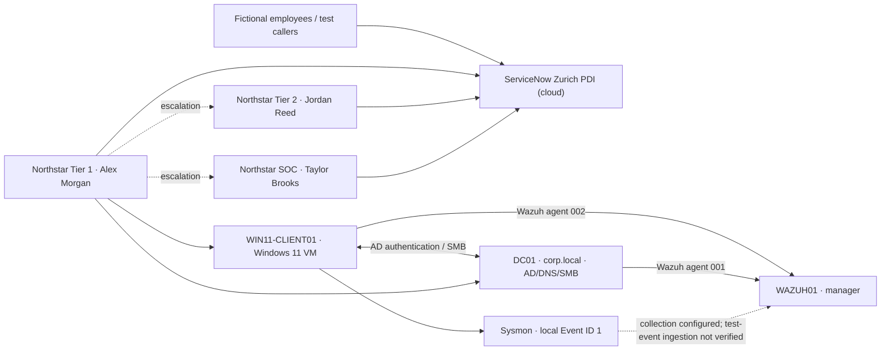

# Lab architecture

**Boundaries:** diagram represents a training environment, not a production network. ServiceNow PDI tasks and lab-host events were manually correlated; no ServiceNow-to-Active-Directory integration or automated SOC ticket creation was demonstrated.

**Note:** The two Windows virtual NICs and other VirtualBox adapters are simplified here; this diagram is logical rather than a precise Layer 2 network map.
